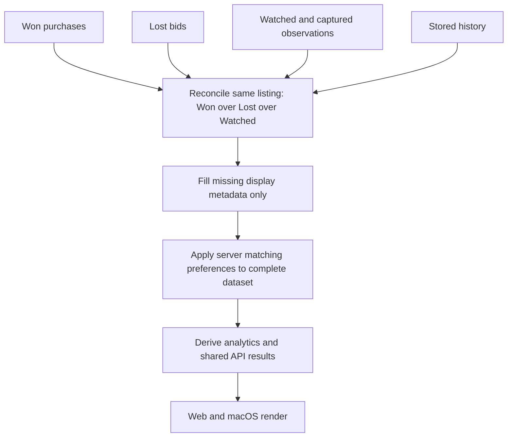
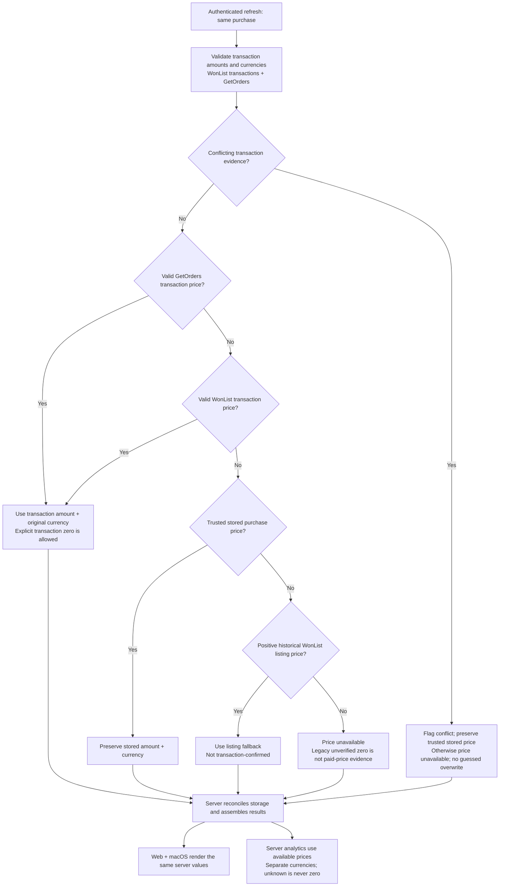

# Design

## Approved assembly model (user sign-off)

The user approved implementing listing-identity reconciliation before matching, with Won > Lost > Watched authority. Acquisition may be parallel. Preserve lower-authority source observations in existing tables; do not delete history to deduplicate. Merge safe missing display metadata only, never substitute watched prices/dates for paid price or bid outcome. Recompute matching from current server preferences only after assembly; distinct listings with the same product remain distinct observations.

Use one pure server reconciliation function for history, capture candidates, matched sales, trends/deals, and assistant datasets. Include persisted lost facts when resolving captured observations. Reconcile by item ID before filtering by group or currency so a purchase with missing price or another currency cannot fall through to a watched price. Capture status is independent of outcome. Won purchases and lost bids are part of the complete ended-history dataset, even if never watched/captured. Preserve raw source records for audit; authoritative assembled reads resolve overlap without destructive deletes.

The user requires a read-only proposed-change table before committing the feature or applying repairs to the live database. The existing running standalone backend is not restarted during implementation. No production repair, migration, or new-code authenticated refresh is permitted until that table is reviewed. Record unverifiable paid prices as unresolved, never propose watched price as a paid-price repair. No new schema fields are approved in this step. The transient source of a parsed price may guide live merging but is not evidence of durable provenance. Legacy zero cleanup remains deferred if transaction evidence is absent.

## Evidence and remaining investigation
WonList currently uses blocks(listXml, "Item").map(parseItem), so surrounding TransactionPrice is unavailable to parseItem. GetOrders already parses TransactionPrice but overlap merging prefers WonList CurrentPrice. Default order lookup is now-minus-90 through now-minus-60 days. parseMoney turns an empty amount into zero. The database already stores affected zeros; a client formatting patch would not fix analytics.

Before finalizing implementation, compare sanitized per-item price fields from live WonList/order responses using existing active-session credentials. Never persist or log tokens, codes, signed state, or complete upstream payloads. A session-authenticated, CSRF-protected read-only purchase-repair preview endpoint will support the user review gate. It fetches live transaction evidence and compares it with stored purchases without invoking persistence or returning credentials. It is not deployed during this step. If the payload contradicts this design or requires another data source, return for design review.

## Price semantics
Parse WonList OrderTransaction wrappers, including standalone Transaction and Order.TransactionArray.Transaction shapes, retaining the associated item and transaction amount. An actual transaction price takes precedence over listing CurrentPrice; GetOrders transaction evidence takes precedence over listing-only fallback. Preserve amount and currency together. Missing, empty, malformed, or non-finite amounts are unavailable, never silently zero. An explicit numeric zero from authoritative transaction evidence is not automatically invalid. A listing-only zero is not proof of a free purchase. Do not use order totals, shipping/tax amounts, converted prices, or a current Browse asking price as paid item price.

## Proposed paid-price resolution (review before implementation)

This diagram describes the proposed behavior, not the current implementation. The amount is the item transaction price per unit in its original currency, excluding shipping and taxes; it is not the full order total or a currency-converted value. Matching is to the same purchase/item, never merely a similar title. Ambiguous repeated purchases must not silently share another transaction's price.

Source order is GetOrders transaction, then WonList transaction, then a trusted stored purchase price, then a strictly positive historical WonList listing fallback, then unavailable. GetOrders and WonList disagreeing on amount or currency is a conflict, not permission to choose arbitrarily; no overwrite with conflicting live evidence. Empty, malformed, negative, or non-finite values and missing currencies are invalid. An explicit zero is accepted only with transaction evidence. A positive stored value from the legacy importer may be retained as a legacy fallback, but must not be described as transaction-confirmed. Listing fallback must not downgrade a transaction-confirmed stored value.

Zero handling and provenance remain a design gate: the existing schema records no price source. Before reconciliation, determine how the implementation can distinguish transaction-confirmed zero from legacy placeholder zero across restarts. If durable source metadata is needed, amend the schema/spec design and obtain user approval before that expansion. Do not erase all zero records or claim that an existing zero is verified without evidence. Review whether clients need a server-provided source/status label for fallback or conflict; clients must never infer that status themselves.

Examples: listing USD 0 + transaction USD 25 resolves to USD 25; blank amount with no fallback resolves to unavailable; authoritative transaction USD 0 remains zero; no live price plus a trusted stored USD 25 preserves USD 25. Current Browse asking prices, order totals, shipping/tax amounts, and title-matched other sales never substitute for paid item price.

## Recovery gate before database changes

Follow AGENTS.md's Database Safety Copies rule before repair/migration or running changed refresh code against existing records. Copy both schema and contents locally under ignored `.local/db-backups/`, verify integrity and isolated restore, and record a non-secret manifest and restore instructions. Retain the verified recovery copy through deterministic checks and user functional sign-off. No database changes or backups have been performed during this planning step. The backup location and verification results will be recorded in tasks before mutation.

## Coverage and reconciliation
Use paginated GetOrders over the supported recent-history interval, including recent purchases and the existing older supplement, within eBay limits. Preserve warnings on partial/unavailable order retrieval and keep historical purchase rows. Keep network work bounded and avoid unbounded per-item requests.

Normal authenticated refresh MUST NOT overwrite existing purchase amounts or currencies, even when newly resolved transaction evidence differs. Collect proposed corrections in the read-only preview; apply them only through a separately approved repair after backup verification. New imports may use validated transaction prices. Do not replace a known nonzero stored price with missing or listing-placeholder data. Do not modify legacy zero records without transaction verification and user approval; the repair preview marks them unresolved. The final zero-price repair remains blocked until then; this must be consistent in persisted reads and all server analytics/assistant consumers. Prefer an idempotent, narrowly scoped reconciliation using existing schema and test its runtime writes. Do not blindly null genuine transaction-confirmed zero purchases. If distinguishing genuine zeros requires durable provenance beyond the existing schema, stop and revise this design before implementing that expansion. No speculative database edits during planning.

## Shared architecture
All source precedence, validation, reconciliation, price availability, matching and business search preferences live under src/ and app/api/. Both clients consume the same assembled result. Their existing price-unavailable rendering should suffice. Any necessary client change is presentation only.

## Verification and rollout
Regression fixtures cover WonList wrapper variants, listing zero with nonzero transaction amount, blank amount, explicit transaction zero, mixed currencies, duplicate source precedence, order coverage and partial failures. Persistence integration verifies repair, idempotence, preservation of good history, and no OAuth credential schema/runtime persistence. Verify charts, matched sales and assistant data agree with purchases. Run relevant unit/integration checks, build and OpenSpec validation; report known lint tooling limitations. After implementation, pause for user testing on both clients before review/shipping. Deployment/restart requires explicit authorization.

## Sources
https://developer.ebay.com/devzone/xml/docs/reference/ebay/GetMyeBayBuying.html
https://developer.ebay.com/DevZone/XML/Docs/Reference/ebay/GetOrders.html

## Implementation refinements within approved scope

The server now supplies complete analyticsItems and purchaseChartPoints. Web and macOS remove their independent analytics unions/outcome inference, and capture/delete interactions reload server results. The server recomputes product groups using current preferences after identity resolution, including in AI tool results. There is no schema migration in this change. Existing unverified zero rows are review candidates, not automatically nulled. Fresh transaction evidence can propose price repairs; absence of evidence cannot establish a replacement price. Read-time precedence does not rewrite lower-authority source records: they remain audit observations.

The advisory review identified automatic refresh as a possible bypass of the review gate. Normal import now preserves amount, currency and purchase date on all existing purchase rows; metadata refresh and imports of genuinely new rows remain normal operations. A separate approved price-repair write path is intentionally not enabled in this step.

The web Purchases card also calculates paid-minus-average and percentage difference locally. Move those derived values and the independent-comparison eligibility decision to the matched-sales summary API; the client formats the returned values only. This follows the approved server-only pricing rule.

The read-only preview also includes transaction-date corrections when evidence is available; the importer cannot silently apply them.

## Final security review: authoritative capture eligibility

The final advisory review identified that capture still accepted client-supplied titles/dates for otherwise price-verified listing IDs. Resolve this within the approved server-only assembly scope before committing: the capture route requires active-session eBay authorization and treats input only as selected IDs. The server constructs eligibility from the user's stored canonical won/lost/captured observations plus freshly authenticated ended-watchlist observations. Persist only that server metadata and independently resolved native price; unknown or still-active watched IDs are skipped even if a Browse price exists. Never mutate existing raw captured observations merely to reconcile authority. Add regression tests for forged title/date/status/IDs and per-user isolation. Re-run affected validation/security review. Web capture functional recheck is required after deploying this follow-up; previous sign-off for other behavior remains recorded.

## Seller identity/display-label finding during macOS testing (proposed amendment)

The user reports the updated macOS app otherwise works, but 11 corrected purchases display seller value `201977996` instead of facerecords. Read-only inspection confirms these numeric values already existed before the approved price repair; that repair did not change seller fields. Nine same-listing captured observations carry facerecords. Two additional purchases have other numeric seller values. eBay documents that some Trading UserID/SellerUserID fields may return immutable IDs instead of usernames (effective September 26, 2025 for selected developers/users). A numeric identifier is therefore not automatically corrupt, and numeric-only usernames must not be globally rejected.

The current shared model conflates seller identity and display username in sellerUserId. Strict whole-field source precedence retains the numeric purchase value and never fills the label from lower-level evidence because the field is nonempty. This is a server metadata issue shared across clients, not a macOS formatting issue.

Proposed next step, pending user design review: preserve seller identity and resolve a separate display username/label server-side from explicit username-bearing eBay listing metadata or corroborated same-listing observations; do not hardcode a numeric-ID-to-name mapping or derive the label independently on clients. Update profile-link behavior so immutable IDs are not assumed to be usernames. Define conflict/staleness and unavailable-label behavior before implementation. Any persistence expansion or metadata repair requires reviewed schema/data design, verified recovery copy, proposed-change inventory and user approval. No seller-field writes or schema expansion have been performed for this finding.

Sources: https://developer.ebay.com/Devzone/xml/docs/Reference/ebay/GetMyeBayBuying.html and https://www.developer.ebay.com/devzone/xml/Docs/Reference/eBay/types/OrderType.html

## Approved seller-label resolution — implementation step

User approved implementation and explicitly authorized commit/merge after passing security reviews. No schema or seller-record rewrite is needed: preserve sellerUserId verbatim and add response-only sellerUsername, sellerDisplayName and sellerProfileUrl. Resolve these once on the server for complete history, analytics, home feed/search and assistant data. Clients render the supplied label/link only.

Evidence rules: explicit Browse seller.username is a username, including valid numeric-only usernames. Legacy non-numeric, non-masked seller values are compatible historical username observations; an untyped numeric legacy value alone is not proof of a username. Corroborate an identity/username association only from observations of the exact same listing within the active user's assembled dataset, then reuse an unambiguous association for that same identity within that response. Do not join by product title, hardcode facerecords, cache across users, or rewrite raw IDs. Explicit username evidence outranks legacy evidence; contradictory equal-strength names or multiple opaque IDs for the same listing prevent inferred association. No associated username means a clearly labeled seller-ID fallback with no /usr/ profile link. Known usernames receive first-party encoded profile links, including numeric-only usernames.

The nine captured same-listing pairs provide an association for all eleven purchases sharing that seller identity, including the two without captures. Masked or blank seller names cannot establish a profile link. Tests cover authority preservation, same-listing corroboration, user isolation, ambiguous associations, explicit numeric usernames, fallback labels and unsafe path encoding. Existing financial values and persistence schemas remain unchanged. User's latest authorization permits commit/merge after these checks and security review; record any manual follow-up honestly rather than claiming an unperformed test.
